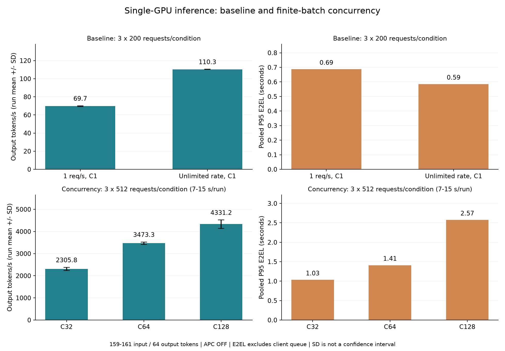

# vLLM 单卡推理性能项目：完整学习与复习手册

适用项目：vLLM Inference Performance Lab（W6–W8）。整理日期：2026-10-28。

这份文档按“已经能跟着步骤运行实验，正在补齐终端、推理原理和性能分析基础”的阶段编写。目标不是让你背完所有术语，而是让你能独立回答：**测的是什么，为什么这样测，结果说明什么，哪里还不能下结论。**

代码与参数以本项目验证过的 vLLM 0.31.0 为准。文中“本项目实测”来自归档；“原理”用于解释机制；“假设”需要进一步实验，三者不能互相替代。

## 如何使用这份手册

第一遍按第 1–7 章读懂基础与指标，不急着记命令。第二遍读第 8–13 章，对照自己的报告与代码。第三遍遮住答案做第 16 章，再练习第 17 章的项目讲解。

只剩十分钟时，读配套 [速查表](study-cheatsheet.md)。真正重跑实验时，打开 [基线/并发步骤](baseline-concurrency.md) 或 [APC 步骤](reproduction.md)，不要把复习材料当作另一套实验协议。

### 目录

1. [项目究竟完成了什么](#chapter-01)
2. [先认识整个运行环境](#chapter-02)
3. [终端、路径和命令怎么读](#chapter-03)
4. [一次模型请求怎样执行](#chapter-04)
5. [KV Cache、分块与前缀缓存](#chapter-05)
6. [性能指标：从时间线理解公式](#chapter-06)
7. [并发、到达率与批处理](#chapter-07)
8. [W6：怎样理解自己的基线](#chapter-08)
9. [W7：怎样理解吞吐与延迟的取舍](#chapter-09)
10. [W8：怎样证明 APC 的收益](#chapter-10)
11. [怎样设计可信的实验](#chapter-11)
12. [这次项目的故障复盘](#chapter-12)
13. [代码、证据文件和自动检查](#chapter-13)
14. [监控与性能诊断](#chapter-14)
15. [不启动 GPU 的复习练习](#chapter-15)
16. [自测题与参考答案](#chapter-16)
17. [面试讲解与能力边界](#chapter-17)
18. [复习安排、术语与参考资料](#chapter-18)

<a id="chapter-01"></a>

## 1. 项目究竟完成了什么

### 1.1 一句话说明

你搭建并测试了一个单 GPU 大模型推理服务，用固定输入和重复实验，研究：

- 同一服务的基础表现是否稳定；
- 同时处理更多请求时，吞吐与单请求延迟怎样变化；
- 请求拥有相同长前缀时，前缀缓存能节省什么工作。

这是**推理服务性能实验与可复核工程项目**。没有训练新模型，也没有重新实现 vLLM 引擎。

“没有改引擎”不代表没有工程工作。数据构造、控制变量、发现测试脚本错误、保存证据、复算统计和界定结论，都是性能工程中实际需要的能力。

### 1.2 最终完成情况

| 阶段 | 研究问题 | 设计 | 成功请求 |
|---|---|---|---:|
| W6 基线 | 基础表现、到达率、重复性 | 2 条件 × 3 轮 × 200 请求 | 1200 |
| W7 并发 | 吞吐与延迟取舍 | 3 并发 × 3 轮 × 512 请求 | 4608 |
| W8 APC | 共享前缀是否带来收益 | 2 输入类型 × 2 开关 × 5 轮 × 100 请求 | 2000 |
| 合计 | 三个层次的问题 | 35 轮 | 7808 |

35 轮全部成功，但“请求成功”只是第一层验收。还检查了实际 token 数、配置、缓存状态、输入一致性和统计公式。

### 1.3 实际硬件与环境

| 项目 | 本项目记录 | 你应理解的含义 |
|---|---|---|
| GPU | RTX 4080 Laptop GPU，约 12 GB | 笔记本版本，不能写成桌面 RTX 4080 |
| 系统 | Windows 上的 WSL Ubuntu | 命令与 Python 实际在 Linux 环境运行 |
| 模型 | Qwen2.5-1.5B-Instruct | 约 15 亿参数的指令模型，1.5B 不是显存大小 |
| 权重计算精度 | FP16 / half | 常见半精度数值格式；不等于 INT4/INT8 量化 |
| vLLM | 0.31.0 | 推理引擎与服务/压测工具版本 |
| PyTorch | 2.13.0+cu132 | 模型计算依赖；后缀标识该构建的 CUDA 版本系列 |
| Transformers | 5.17.0 | 本项目使用其中的 tokenizer 等组件 |
| Python | 3.12.3 | 解释器版本 |
| 上下文上限 | 4096 tokens | 本实验服务给每条序列设置的输入与输出总长度预算 |

这些版本来自本次环境，不是给所有机器的安装推荐。CUDA 构建、驱动、GPU 和软件需要匹配，不能认为换机器后复制版本号必定运行。

### 1.4 三个阶段不是同一个优化倍数

W6/W7 输入为 159–161 tokens，W8 输入为 2039–2041 tokens，输出都固定 64。

因此：

- W7 内部的 C32/C64/C128 可以比较；
- W8 内部共享输入 OFF/ON 可以比较；
- 不能用 W6 的 110 tokens/s 与 W7 的 4326 tokens/s 相除，就说“我优化了引擎 39 倍”；
- 也不能把 W8 的 TTFT 降低 81.59% 写成“整个项目所有请求快了 81.59%”。

分母、负载和实验条件必须对得上。[项目总报告](../reports/project-report.md) 是这些结论的正式版本。

<a id="chapter-02"></a>

## 2. 先认识整个运行环境

### 2.1 你电脑里的几层东西

```text
Windows
└── WSL Ubuntu
    ├── 项目代码与输入数据
    ├── Python 虚拟环境
    │   ├── vLLM
    │   ├── PyTorch
    │   └── Transformers
    └── 访问 GPU，加载本地模型
```

WSL 提供 Linux 运行环境；虚拟环境提供一套 Python 与包；模型目录保存权重和 tokenizer 文件。它们不是同一个东西。

### 2.2 为什么项目目录和虚拟环境目录不同

本机代码在：

```text
/home/administrator/vllm-lab-1
```

虚拟环境在：

```text
/home/administrator/ai-infra/.venv-vllm
```

你可以在项目目录运行虚拟环境里的 Python。项目不需要把依赖包复制到自己目录，更不应该把几 GB 的虚拟环境上传 GitHub。

激活环境改变当前终端寻找 python、vllm 等命令的位置；它不会启动模型服务，也不会修改模型权重。

### 2.3 模型、tokenizer 与推理引擎分别是什么

| 名称 | 作用 | 类比的边界 |
|---|---|---|
| 模型权重 | 神经网络经过训练后的参数 | 可以理解为已学习的数值参数，不能简单等同于一份知识数据库 |
| tokenizer | 文本与 token ID 之间转换 | 类似编码规则，不负责推理答案 |
| chat template | 将对话角色和文本组织为模型要求的格式 | 类似消息格式协议，会增加控制标记 |
| vLLM | 调度请求、执行推理、管理缓存、提供接口 | 是执行与服务系统，不是另一份模型 |
| benchmark | 构造请求并测量结果 | 是测试客户端，不是服务端引擎 |

同一模型可以由不同框架运行；不同框架、版本或参数可能产生不同性能，不能只记录模型名字。

### 2.4 localhost、端口和 API

127.0.0.1 表示本机回环地址。本项目服务地址是：

```text
http://127.0.0.1:8000
```

8000 是端口，表示访问这台机器上的哪个服务入口。

| 路径 | 请求目的 |
|---|---|
| /health | 检查服务健康状态 |
| /v1/chat/completions | 发送对话生成请求 |
| /server_info?config_format=json | 读取实际服务配置 |
| /reset_prefix_cache | 请求重置前缀缓存 |
| /metrics | 读取服务指标 |

这些路径中部分属于本版本实验接口，项目启动脚本设置了 VLLM_SERVER_DEV_MODE=1。它们不是所有部署都默认开放的通用协议。

**/health 返回 200，不等于你的生成请求一定合法。** 服务可以正常存活，但拒绝过长输入或不正确参数。

<a id="chapter-03"></a>

## 3. 终端、路径和命令怎么读

### 3.1 区分 PowerShell 与 Bash

Windows PowerShell 中进入 Ubuntu：

```powershell
wsl -d Ubuntu-24.04
```

进入后再执行本文的 Bash 命令。source、which、tail 等命令不要直接套进普通 PowerShell。

终端提示符如 (.venv-vllm) administrator@w:~/vllm-lab-1$ 是环境提示，不属于命令，不能一起复制。

### 3.2 先进入目录，再激活环境

```bash
cd /home/administrator/vllm-lab-1
source /home/administrator/ai-infra/.venv-vllm/bin/activate
pwd
which python
```

逐行理解：

1. cd：进入指定目录。
2. source：在当前终端加载激活脚本。
3. pwd：查看当前工作目录。
4. which python：确认将使用哪个 Python。

每个新终端都需要检查环境。A 激活了，不代表 B 自动激活。

### 3.3 绝对路径和相对路径

- /home/administrator/vllm-lab-1/data/baseline.jsonl 是绝对路径。
- data/baseline.jsonl 是相对路径，要从当前目录开始找。
- ../README.md 表示上一级目录中的 README。
- WSL 的 /mnt/d 一般对应 Windows 的 D 盘。
- Windows 的 \\wsl.localhost\Ubuntu-24.04\home\administrator\vllm-lab-1 与 Linux 项目路径是两种访问表示，不要直接混进同一条 Bash 命令。

如果显示“找不到脚本”，先看 pwd，别马上重新安装依赖。

### 3.4 拆开读一条压测命令

下面是**预览**：不会启动 GPU 请求，也不会创建结果目录。

```bash
python scripts/run_benchmark.py --model /mnt/d/models/Qwen2.5-1.5B-Instruct --dataset data/baseline.jsonl --output-dir runs/review-preview/low_rate_run1 --apc off --cache-state cold --concurrency 1 --request-rate 1 --dry-run
```

可以把它读成一句话：

> 使用当前 Python 运行单轮测试脚本，读取固定基线数据，期望服务缓存关闭，不做同前缀预填充，客户端并发为 1、期望到达率为 1，把计划结果位置设为新目录；这次只打印计划，不执行。

| 组成 | 解释 |
|---|---|
| python | 用当前环境的解释器 |
| scripts/run_benchmark.py | 运行哪个文件 |
| --model 后的路径 | 模型与 tokenizer 的位置 |
| --dataset 后的路径 | 读哪份输入 |
| --output-dir 后的路径 | 本轮结果放哪里 |
| --apc off | 核验服务应该关闭 APC，不是替服务修改配置 |
| --cache-state cold | 不发同前缀预填充请求 |
| --concurrency 1 | 客户端并发许可上限 |
| --request-rate 1 | 请求到达参数 |
| --dry-run | 只预览 |

两个减号表示长参数名。参数名之后通常跟值；--dry-run 这类开关不需要再写 true。

### 3.5 另外几个常用命令

| 命令 | 用途 | 容易误解的地方 |
|---|---|---|
| python -m json.tool 文件 | 格式化显示 JSON | 不修改文件 |
| tail -n 40 文件 | 查看最后 40 行 | 不是只保留 40 行 |
| wc -l 文件 | 统计行数 | JSONL 一行一个请求时，可辅助核对请求数 |
| mkdir -p 目录 | 创建目录，允许父目录已存在 | 不表示目录中的数据一定可覆盖 |
| Ctrl+C | 中断当前前台程序 | 不应在正式测量进行中随意停止服务 |
| > 文件 | 把输出写入文件 | 默认可能覆盖已有文件 |
| set -o noclobber | 当前 Bash 阻止普通重定向覆盖已有文件 | 是终端设置，不是永久保护全部文件 |

本项目用“新目录必须不存在”阻止误覆盖。出现 FileExistsError，先辨认该目录是不是已有证据，不要直接删掉再跑。

### 3.6 三个终端各做什么

| 终端 | 职责 | 正常运行时的表现 |
|---|---|---|
| A | 模型服务 | 持续运行，不回到提示符 |
| B | 单轮压测和分析 | 每条命令结束后返回提示符 |
| C | GPU 采样 | 持续写 CSV，手动结束 |

B 的正式日志写到文件，屏幕安静不一定是卡住。先检查日志、进程与服务状态。

<a id="chapter-04"></a>

## 4. 一次模型请求怎样执行

### 4.1 从输入到输出的流程


这是帮助理解的逻辑流程，不是逐行对应某个线程。实际实现可以异步处理、混合调度多个请求。

### 4.2 token 不是字符，也不是单词

模型处理 token ID 序列，而不是直接处理“字数”。

同一段文字可能因 tokenizer 不同产生不同 token 数。中文、英文、数字、空格和标点的切分规则也不同。

例如“重复某个词 2000 次”不等于“输入 2000 tokens”。你曾经遇到的预热越界，就是用文本重复次数估计 token 长度造成的。

**做实验应检查实际 tokenizer 输出和 result.json 的 input_lens，而不是凭字符数猜。**

### 4.3 chat template 为什么影响输入长度

原始请求可能只有：

```json
{"role": "user", "content": "解释一下吞吐量"}
```

模型实际需要知道谁在说话、哪里结束、接下来该由谁回答。模板会加入角色和边界标记，因此模型看到的序列比原文多。

本项目把原始 prompt 交给服务端套一次模板。压测客户端加 --skip-chat-template，是为了避免先在客户端套一次、服务端再套一次；**不是关闭服务端需要的模板**。模板和特殊 token 的重复会改变实际输入，官方 Transformers 文档也提醒避免重复添加。[Chat templates](https://huggingface.co/docs/transformers/chat_templating)

旧探索中，正确一次模板约 2039 tokens，重复后出现 2068。修复之后要重新测量，不能只把表格标题改成“2039”。

### 4.4 Prefill：先处理已有输入

输入 prompt 已经完整存在，可以在满足因果注意力约束的前提下并行计算多个输入位置。

这一步建立模型继续生成所需的中间状态。输入很长时，它可能成为首 token 等待的重要部分。

初学时可以记为：

> Prefill 处理“用户已经给出的内容”。

不要进一步误记为“TTFT 就是纯 prefill 时间”。客户端 TTFT 还可能包含服务排队、传输、调度和其他首次开销。

### 4.5 Decode：根据前文继续生成

生成后面的 token 通常需要知道前面已经生成的 token，所以常规自回归生成有逐步依赖。

初学时可以记为：

> Decode 处理“模型接下来要写出的内容”。

一个请求内有顺序依赖，不代表 GPU 全程只能算一个请求。不同请求可以被一起调度，这是并发与批处理能提高总吞吐的基础。

Prefill 常有较强计算需求，decode 在某些负载下容易受内存带宽影响，但这只是理解方向，不是对所有模型、批大小和硬件都成立的固定判定。

### 4.6 Chunked Prefill 是什么

长输入的 prefill 可以拆成若干块参与调度，减少一次长输入处理对其他请求的长期占用。本项目启用了 chunked prefill，并把每次调度的 token 预算设为 2048。

这个预算是跨本次调度工作的限制，不是“每个请求最多输入 2048”。本项目上下文上限仍是 4096。[vLLM 优化说明](https://docs.vllm.ai/en/v0.31.0/configuration/optimization/)

我们没有做 chunked prefill 开关对照，所以不能声称自己测出了它的独立收益。

<a id="chapter-05"></a>

## 5. KV Cache、分块与前缀缓存

### 5.1 为什么生成需要 KV Cache

注意力计算中，每个位置会形成 Key 和 Value 等中间结果。后续生成要参考历史内容，如果重复计算所有历史位置，会浪费工作。

KV Cache 保存历史位置的 Key/Value，供后续步骤使用。它是运行时中间状态，不是模型权重，也不是历史答案文本。

不需要现在推导完整注意力公式，但要能说清：

- 权重是已经训练好的模型参数；
- KV 是针对当前输入/生成历史计算的状态；
- 输入越长、并发请求越多，KV 内存压力通常越大。

### 5.2 一个帮助估算的公式（进阶，可后读）

对简单、同构的注意力层配置，KV 的粗略元素存储量可以写成：

```text
KV bytes ≈ 2 × 层数 × KV heads 数 × 每个 head 的维度
           × 缓存 token 数 × 每个元素字节数
```

2 来自 K 和 V；FP16 元素通常 2 字节。多个独立序列要考虑各自 token 数之和。

这是结构性估算，不是本项目实测公式。实际还涉及分块、对齐、共享前缀、KV dtype、GQA/MQA、并行切分或混合结构。尤其不要把 query heads 数直接当 KV heads 数，也不要用 1.5B 权重参数量直接推 KV 占用。

### 5.3 分块缓存和 APC 是两个相关但不同的问题

将 KV 按 block 管理，有助于组织不同长度请求的缓存空间。APC 在此基础上判断“已有缓存是否可以供新请求复用”。

- 缓存管理关注空间怎样分配、引用和回收；
- APC 关注相同前缀的计算结果是否可以复用；
- 把 block_size 从 16 改成其他数，不等于一定提升 APC 命中收益。

本项目只记录了 block_size=16，没有做 block_size 调优实验。

### 5.4 普通 KV Cache 与 APC 的区别

| 功能 | 主要复用范围 | 复用内容 |
|---|---|---|
| 单条生成中的 KV Cache | 同一条序列随生成推进 | 已计算历史位置的 K/V |
| Automatic Prefix Caching | 新请求与之前请求有相同前缀 | 可匹配前缀对应的 K/V blocks |
| 答案缓存 | 应用自行缓存完整回答 | 最终文本结果 |

APC 不等于“问题一样就把旧答案直接返回”。不同结尾的问题仍需处理剩余输入并生成各自回答。

### 5.5 为什么必须从开头相同

注意力状态受前文影响，所以相同的一段词语如果处在不同上下文中，不能随便复用同一个 KV。

```text
请求 A：共同长文档 + 问题 A
请求 B：共同长文档 + 问题 B
        ↑ 从开头连续相同，适合考察前缀复用

请求 C：不同开头 + 某段相同文字
请求 D：另一开头 + 某段相同文字
        ↑ 不能因为中间文字相同，就认为对应 KV 一定可复用
```

vLLM 的前缀缓存设计使用块内容、之前前缀的关联信息等构造缓存标识，并以完整块为基本缓存单位。[前缀缓存设计](https://docs.vllm.ai/en/v0.31.0/design/prefix_caching/)

因此，实验中把随机 ID 插在文本开头，可能大幅破坏前缀复用，即使后面长文档看起来都一样。

### 5.6 LCP 是什么

LCP 是 Longest Common Prefix，最长公共前缀。

示意 token 序列：

```text
A = [10, 20, 30, 40, 50]
B = [10, 20, 30, 99, 88]
LCP 长度 = 3
```

比较的是 token ID，不是人眼看起来相似的文字。

本项目共享输入 LCP 约 2029–2031，独立输入约 27–29。独立输入仍有共同模板，所以“独立”不等于“完全没有共享 token”。

### 5.7 APC 主要改变什么

APC 通过复用前缀 KV，减少重复输入的 prefill 工作；它不会把新回答直接变成已有答案，也不会消除新 token 的常规生成工作。[APC 官方说明](https://docs.vllm.ai/en/v0.31.0/features/automatic_prefix_caching/)

因此，如果长输入具有可复用前缀，应重点观察 TTFT。若输出很长，decode 占总时间更大，TTFT 大幅下降也未必带来同样比例的整段请求加速。

本项目正好观察到：共享组 TTFT 明显下降，TPOT 变化很小。

<a id="chapter-06"></a>

## 6. 性能指标：从时间线理解公式

### 6.1 先画四个时间点

```text
t0                t1                  t2                     t3
请求到达客户端     获得许可并发送       收到第一个输出 token     请求完成
|------ Q --------|------ TTFT --------|------ 后续输出 --------|
                  |---------------- E2EL ---------------------|
|------------------- 到达至完成 -------------------------------|
```

在本项目所用版本中，queue_times 单独记录客户端等待并发许可等发送前延迟；TTFT 与 E2EL 从发送侧开始计时。服务端内部等待仍可能包含在后两者中。

这不是所有工具都必须遵守的定义。换 benchmark 后必须读它的字段说明或代码，不能只认缩写。

### 6.2 TTFT：多久看到第一个 token

Time To First Token：

```text
TTFT = t2 − t1
```

用于衡量开始响应的速度。不能仅凭 TTFT 上升就认定 GPU prefill 内核变慢，因为服务排队、调度、CPU 或传输也可能改变它。

### 6.3 E2EL：实际发送后多久完成

End-to-End Latency，在本工具中：

```text
E2EL = t3 − t1
```

它包括首 token 等待与后续输出阶段，但不包括本图 Q。

名称里有“端到端”也不自动保证“从外部用户进入系统到完全结束”。端点定义要明确。

### 6.4 TPOT：首 token 后，每个输出间隔的平均成本

Time Per Output Token：

```text
TPOT = (E2EL − TTFT) / (输出 token 数 − 1)
```

假设一个请求：

- 输出 64 tokens；
- TTFT=20 ms；
- E2EL=650 ms。

那么 TPOT=(650−20)/(64−1)=10 ms/token。

为什么除以 63？64 个 token 中，第一个已经由 TTFT 覆盖，剩下有 63 个输出间隔。

输出少于 2 tokens 时，这个公式没有通常意义。本项目输出固定为 64，避免了这个边界。

### 6.5 ITL：相邻输出之间的间隔

Inter-Token Latency 强调输出过程中相邻 token 的时间间隔。

TPOT 是单请求剩余时间除以输出间隔数；ITL 往往收集多个流式间隔。统计对象、聚合权重、网络缓冲和流式分片方式不同，二者不能默认数值完全一样。

入门阶段先能正确使用 TTFT、TPOT、E2EL；不要把所有“每 token 时间”混成一个字段。

### 6.6 吞吐：单位时间完成多少工作

请求吞吐：

```text
完成请求数 / 测量时间，单位 requests/s
```

输出 token 吞吐：

```text
总输出 tokens / 测量时间，单位 tokens/s
```

本项目主表用第二种。比如 200 请求、每个 64 输出，总输出是 12800 tokens；若 duration=116 秒，吞吐约 110.34 tokens/s。

不要把“输入+输出总 token 吞吐”与“输出 token 吞吐”放在同一张表直接比较。本项目报告明确写 output throughput。

### 6.7 单请求速度与总吞吐可以同时向相反方向变化

多请求一起运行，GPU 总产出可能增加，但每个请求等待或竞争资源的时间也增加。

因此“吞吐提高了”与“每个用户更快收到回答”不是同义句。W7 就是你的实测例子。

### 6.8 P50、P95、P99

把耗时从小到大排序：

- P50 描述中间位置；
- P95 描述靠近慢端的位置；
- P99 更关注尾部。

项目采用线性插值，所以 P95 未必等于列表中某一个实际观测值。

例如 [1,2,3,4] 的 P95，位置为 (4−1)×0.95=2.85，落在 3 和 4 之间，结果为 3.85。

“P95=1 秒”应理解为这批观测的约 95% 分位水平，不是保证任何未来用户都不超过 1 秒。样本少时，尤其不要过分相信 P99 的稳定性。

### 6.9 不能把两个 P95 相加

每条请求的客户端等待 Q 与发送后延迟 L 配对：

```text
先计算 A[i] = Q[i] + L[i]
再计算 P95(A)
```

错误写法：P95(Q)+P95(L)。

教学反例：Q=[0,0,100]，L=[100,0,0]。分别的 P95 都是 90，相加得到 180；但逐项相加后是 [100,0,100]，P95 是 100。

原因是最慢的两个部分可能发生在不同请求上。

### 6.10 多轮吞吐、均值和标准差

合并吞吐应使用：

```text
所有轮次的总输出 tokens / 所有轮次的总测量时间
```

教学例子：两轮都输出 1000 tokens，分别耗时 10 秒和 20 秒。

- 两轮吞吐分别 100、50；
- 简单平均是 75；
- 合并吞吐是 2000/30≈66.67。

本项目 CSV 同时保存“合并吞吐”与“轮吞吐平均值”，图中吞吐柱采用轮均值 ± 轮间样本标准差，表中主值采用合并吞吐。要读清标签。

样本标准差 SD 描述轮次间波动；它不是置信区间，也不是“结果正确的概率”。

不能把 3 轮 × 512 请求当成 1536 次独立环境复现。同轮请求共享硬件状态、服务进程与执行时段。

### 6.11 降低率和加速倍数不是同一个表达

本项目共享组：

```text
TTFT 降低率 = (106.082 − 19.526) / 106.082 ≈ 81.59%
TTFT 时间比 = 106.082 / 19.526 ≈ 5.43
```

可以说“这个负载的平均 TTFT 降低 81.59%”，或说明 OFF 时间约为 ON 的 5.43 倍。

不要写“吞吐提升 81.59%”或“decode 加速 5.43 倍”。它们换了指标。

<a id="chapter-07"></a>

## 7. 并发、到达率与批处理

### 7.1 并发上限控制“同时允许多少”

--concurrency 32 表示客户端最多允许一定数量的正式请求同时处于执行路径中。

它不是“一秒发送 32 个”，也不是“GPU 一定每一步处理 32 个”。实际活跃请求数还取决于到达速度、完成速度和服务调度。

### 7.2 到达率控制“请求多快来到客户端”

--request-rate 1 表示设置期望到达率参数，不保证每隔整整一秒发送一条。

本版本默认到达生成存在随机间隔，有限样本的实际速率也可能与参数不完全一致。客户端并发上限还可能让已到达请求先排队。

不要用 rate×输出长度去强行覆盖实测吞吐，应以保存的 duration 与实际完成数量核算。

### 7.3 request_rate=inf 不代表无限并发

```text
request_rate=inf：不人为加入固定的到达等待。
concurrency=1：仍然一次只允许一个正式请求进入执行路径。
```

大量请求会在客户端等待许可，因此最后一批请求的 Q 可能很长。

这正是 W6 连续单并发 E2EL 约 0.585 秒，而到达至完成 P95 约 110 秒的原因。两个数字描述的时间起点不同，并不矛盾。

### 7.4 客户端并发、max_num_seqs、token 预算

| 参数 | 所在层 | 本项目例子 |
|---|---|---|
| --concurrency | 自己的压测脚本/客户端 | 1、32、64、128 |
| --max-num-seqs | 引擎调度限制 | 256 |
| --max-num-batched-tokens | 单次调度 token 预算 | 2048 |
| --max-model-len | 单序列上下文预算 | 4096 |

把 max_num_seqs=256 误读成“我实际测了 256 并发”是错误的。

### 7.5 批处理为什么可能提高吞吐

GPU 可以一起处理多个请求的计算任务，减少某些逐请求开销并提高硬件利用效率。持续批处理的基本想法是：请求完成后可让其他请求加入后续调度，而不是所有请求必须同进同出。

但批更大不意味着一切都更好。调度、显存、带宽、CPU、输出长度和等待队列都会影响结果。

可以提出“批处理利用效率改善”的解释方向，不能只靠吞吐曲线就声称已经定位到某个内核。

### 7.6 为什么短批次不能代表持续容量

512 条在 C128 下只有少量并发填充波次，启动、填满、收尾占比不可忽略。本项目每轮仅 7–15 秒。

持续服务还可能受长时间温度、功耗、背景任务和到达波动影响。更长测量能减少部分短窗口影响，但“至少约 60 秒”是下一轮工程起点，不是保证实验正确的通用定理。

**当前可以讲有限批次表现，不能讲已测出稳定生产容量。**

<a id="chapter-08"></a>

## 8. W6：怎样建立一个可信的基线

### 8.1 先把研究问题说清楚

W6 要回答的是：在模型、输入、输出和并发固定时，低到达率与连续单并发分别表现怎样？重复运行是否足够一致，能作为后续对照？

它不是“把 GPU 跑到最大吞吐”。并发固定为 1，硬件可能有大量尚未利用的并行能力。

| 条件 | 低到达率 low_rate | 连续单并发 serial |
|---|---|---|
| 客户端并发 | 1 | 1 |
| 请求到达率参数 | 1 request/s | inf |
| APC | OFF | OFF |
| 每轮请求数 | 200 | 200 |
| 重复次数 | 3 | 3 |
| 实际输入 | 159–161 tokens | 同一份输入 |
| 实际输出 | 每条 64 tokens | 每条 64 tokens |

正式计时前，有 3 次不属于正式数据集的服务预热。两组不额外预热数据集前缀。

### 8.2 怎样读自己的结果

| 指标 | low_rate | serial |
|---|---:|---:|
| 合并输出吞吐 tokens/s | 69.69 | 110.34 |
| 平均 TTFT ms | 24.48 | 20.26 |
| 平均 TPOT ms/token | 9.03 | 8.88 |
| 合并 P95 E2EL ms | 687.19 | 585.14 |
| 合并 P95 到达至完成 ms | 3315.81 | 110341.39 |
| 单轮测量时长 s | 182.96–184.79 | 115.87–116.10 |
| 吞吐轮间最大/最小差 | 约 1.00% | 约 0.20% |

“最大/最小差”在这里定义为 (最大轮吞吐/最小轮吞吐−1)×100%，不是标准差，也不是误差率。数字来自 [基线汇总](../reports/baseline-summary.csv) 和 [逐轮表](../reports/baseline-runs.csv)。

### 8.3 为什么连续单并发吞吐更高

同样的 200×64=12800 个输出 tokens：

- low_rate 的测量时间包含到达等待，约 184 秒；
- serial 取消人为到达间隔，约 116 秒完成。

因此总量相同、总时间不同，吞吐不同。不能直接说模型计算本身加速了 58%，更不能把 low_rate 当作 GPU 最大能力。

每条请求的 TTFT 与 TPOT 也略有变化。可以提出服务活跃状态、随机到达、调度等解释方向，但现有记录没有隔离这些原因。最稳妥的说法是“观察到差异，尚未单独识别原因”。

### 8.4 为什么 110 秒与 0.585 秒同时成立

serial 条件下，200 条请求很快到达客户端，但一次只允许 1 条执行。靠后的请求在客户端等待前面的请求完成。

~~~text
请求 A：到达 → 立即发送 → 约 0.58 秒完成
请求 B：到达 → 等 A → 发送 → 约 0.58 秒完成
……
最后一批：到达 → 等前面很多条 → 发送 → 约 0.58 秒完成
~~~

发送后 E2EL 仍约半秒，从最初到达起计算的总等待却可能超过 100 秒。

如果真实业务的用户从进入系统时就开始等待，只报告发送后 E2EL 会漏掉一段体验。这里的队列在客户端；真实部署中还可能存在网关队列等其他位置。

### 8.5 “基线稳定”究竟能说到什么程度

当前三轮的吞吐波动较小，可以作为本项目这些条件下的对照。不能因此保证任意日期、任意电源状态下都一样。

本次实际顺序为 low1 → serial1 → serial2 → low2 → low3 → serial3，而不是简单先全部 low 再全部 serial；顺序比文件夹编号更有意义。

没有逐轮 CPU/GPU 基线时序，因此不能用结果稳定反推“CPU 从未成为瓶颈”或“GPU 温度完全不变”。

旧实验的尾延迟问题在这批数据中没有明显复现，不等于根因已经修复。新旧输入长度、运行时段和环境并不完全相同。

**本章复述目标：能解释吞吐为什么变化，以及为什么必须区分发送后延迟与到达后延迟。**

<a id="chapter-09"></a>

## 9. W7：提高并发，换来了什么

### 9.1 保持什么不变，改变什么

使用同一份 512 条请求的数据，实际输入仍为 159–161 tokens，输出 64，APC OFF，request_rate=inf。

只把客户端并发上限分别设为 32、64、128，每档 3 轮。正式请求总数为 3×3×512=4608。

由于输入比 APC 实验短得多，不应该拿这里的数千 tokens/s 与 W8 的百余 tokens/s 直接计算“缓存优化倍数”。

### 9.2 结果同时看吞吐与延迟

| 客户端并发 | 合并吞吐 tokens/s | 平均 TTFT ms | 平均 TPOT ms/token | 合并 P95 E2EL s | 合并 P95 到达至完成 s |
|---|---:|---:|---:|---:|---:|
| 32 | 2304.25 | 184.49 | 11.16 | 1.033 | 13.877 |
| 64 | 3472.74 | 271.17 | 14.35 | 1.410 | 9.427 |
| 128 | 4325.56 | 421.81 | 23.11 | 2.575 | 7.908 |



可以这样复述：

> 在这份有限批次短输入负载下，提高并发能更快处理完整批次，但单个已发送请求平均等待首 token 和后续输出的时间都增加了。

多人同时使用 GPU，可以提高整批任务的处理效率，同时每人的任务共享资源，单条请求变慢。

### 9.3 为什么到达至完成 P95 反而下降

C32 时很多请求在客户端排队；C128 允许更多请求进入执行路径。单条发送后延迟虽然增加，但客户端排队减少得更多，整批请求更早完成。

判断“体验更好”必须先说清业务：

- 在线交互：关心从用户发起起的首字响应、完整回答和尾延迟；
- 离线批量任务：可能更关心一批作业多久完成；
- 在线系统容量测试：还要约束到达过程、稳定时长、错误率和服务目标。

本项目没有通过一张曲线就同时证明三种业务的最优配置。

### 9.4 能否直接说 C128 最好

不能。它在当前三档中吞吐最高，但发送后 P95 E2EL 也最高，约 2.575 秒。

**以下是教学假设，不是实验前设定的真实验收标准：**

如果业务规定“发送后 P95 E2EL 不超过 1.5 秒”，那么这批结果里 C32、C64 满足，C128 不满足。若在满足约束的档位中选择吞吐更高者，C64 会成为后续验证候选。

但这里的业务标准是事后举例，且测量窗口太短。不能据此宣布“生产最优并发=64”。真实选择还需更长测试、不同输入输出长度和正确的用户等待口径。

### 9.5 重复与硬件证据告诉了什么

| 并发 | 轮吞吐样本 SD tokens/s | 最大/最小差 | 单轮时长 s |
|---|---:|---:|---:|
| 32 | 72.50 | 6.17% | 13.88–14.74 |
| 64 | 52.47 | 3.07% | 9.29–9.58 |
| 128 | 189.66 | 8.31% | 7.36–7.97 |

C128 的轮间波动更大，但三轮不足以精确推断其长期分布。

9 轮都保存了 GPU 采样。正式窗口的抢占计数增量都是 0。这支持“当前记录没有显示这 9 轮发生抢占”，不意味着其他并发或长输入下也不会发生。

GPU 已分配显存约 11700–11800 MiB，其中可能包含预留的缓存池。它不等于实际有效 token 占用，也不是“显存已经满到一定会出错”。

### 9.6 不能忽略时间顺序与短窗口

文件名 run3 并不代表最后跑：

~~~text
较早的一次服务会话：
C64 run3 → C32 run3 → C128 run3

较晚的一次服务会话：
C32 run1 → C64 run1 → C128 run1
→ C128 run2 → C64 run2 → C32 run2
~~~

运行编号只是标识，真实时间应查 manifest 和服务日志。

最短一轮仅 7.36 秒，GPU 采样间隔有时接近 4 秒，短暂峰值可能被漏掉；采样窗口还包含 runner 的预热过程。

当前成果是“有证据的有限批次并发对照”。下一步若研究持续容量，先拉长测量窗口并补足遥测，再考虑更多调参。

### 9.7 旧的退化问题应该怎样保留

以前的 C64 结果曾出现明显退化，但旧条件与新条件不能形成严格单变量对照。本次没有完成从“异常复现”到“定位原因”再到“干预验证”的闭环。

不能因为新数据恢复正常，就把某条 CPU 火焰图路径写成“已定位并修复 GPU 瓶颈”。第 14 章会解释这类证据应怎样使用。

**本章复述目标：能同时讲出并发带来的收益、代价，以及为什么现在还不能宣布最优并发。**

<a id="chapter-10"></a>

## 10. W8：怎样证明前缀缓存对合适的输入有用

### 10.1 两个因素，四个实验组

| 输入类型 | APC OFF | APC ON |
|---|---|---|
| 共享长前缀 shared | shared_off | shared_on |
| 前缀基本不共享 independent | independent_cold_off | independent_cold_on |

每组 5 轮，每轮 100 条；客户端并发 1，rate=inf；实际输入 2039–2041 tokens，输出 64。

为什么需要 independent 组？

只看 shared ON 更快，可能混入环境变化。增加一个预期几乎没有可复用长前缀的组，可以检查“是不是开关打开后所有输入都变快”。本次独立组确实基本不变，加强了对前缀复用机制的解释，但不能消除所有时间顺序混杂。

这是**负对照**：刻意选择一个理论上不应出现同样强收益的条件。

### 10.2 服务预热、缓存预热、冷缓存是三件事

| 名称 | 做了什么 | 解决什么 |
|---|---|---|
| 服务预热 | 先发 3 条与正式前缀无关的请求 | 减少首次执行等启动影响 |
| 缓存清空 | ON 条件下调用 reset 并检查成功 | 控制正式数据前的缓存状态 |
| 前缀预热 | hot 条件额外请求数据集的首个前缀 | 让正式请求开始前已有目标前缀 |

本项目的关键顺序：

~~~text
确认服务配置和输入
→ 3 次无关服务预热
→ 如果 APC ON：清空前缀缓存并验证成功
→ 如果 hot：额外发一条前缀预热请求
→ 读取 metrics_before
→ 测量正式 100 条请求
→ 读取 metrics_after
→ 保存结果和 manifest
~~~

OFF 组不依赖 APC reset 成功；相应字段可以是空值。不能把 OFF 的空值误判为 ON 清空失败，也不能把 ON 失败当作“已经清空”。

冷缓存不是冷启动服务。已经完成服务预热，再清空目标缓存，也可以开始一次 cold 测试。

### 10.3 为什么 shared_off 也执行 hot 预热

OFF 没有前缀缓存，但仍发同样的额外请求，让两组进入正式测量前的请求流程尽可能一致。

“hot”在此描述预热流程。OFF 不会因为这个名字就拥有 APC 命中。

没有目标前缀预热的共享 cold 数据，也可能从正式第二条请求开始命中第一条留下的前缀。**起始 cold 不等于整轮没有命中。**

本次 independent 数据从很前面就发生分歧，所以其 ON 组整轮可复用的部分依然很短。

### 10.4 缓存收益主要在哪里

| 指标 | shared OFF | shared ON | independent OFF | independent ON |
|---|---:|---:|---:|---:|
| 平均 TTFT ms | 106.08 | 19.53 | 105.78 | 105.81 |
| shared 平均 TPOT ms/token | 8.92 | 8.89 | — | — |
| shared 平均 E2EL ms | 668.28 | 579.45 | — | — |
| shared 输出吞吐 tokens/s | 95.74 | 110.41 | — | — |

“—”表示此表未展示，完整值在 [APC 汇总](../reports/prefix-cache-summary.csv)。


共享组：

- 平均 TTFT 降低约 **81.59%**；
- 平均 TPOT 基本不变；
- 平均 E2EL 降低约 **13.29%**；
- 输出吞吐提高约 **15.32%**。

这些比例不一样，因为各指标涵盖的时间不同。APC 主要减少重复前缀的 prefill 工作；64 个新输出 tokens 仍需要 decode，所以总请求时间不会按 TTFT 的幅度同比下降。[vLLM APC 说明](https://docs.vllm.ai/en/v0.31.0/features/automatic_prefix_caching/)

~~~text
原来：较长 prefill + 生成 64 tokens
现在：较短 prefill + 仍然生成 64 tokens
~~~

这也是为什么“TTFT 时间约缩短至原来的 1/5.43”不能写成“整条请求加速 5.43 倍”。

### 10.5 命中率是怎样算出来的

在同一正式窗口读取前后累计计数：

~~~text
Δqueries = queries_after − queries_before
Δhits    = hits_after − hits_before
命中比例 = Δhits / Δqueries
~~~

本项目 ON 组每轮：

| 条件 | Δqueries | Δhits | 比例 |
|---|---:|---:|---:|
| shared ON | 203992 | 201616 | 98.835% |
| independent ON | 203992 | 1584 | 0.7765% |

它是本版本这些指标所计的 token 层面的查询/命中比例，不能写成“98.8% 的用户请求直接返回缓存答案”。

OFF 的 queries 增量为 0，比例应记为“不适用”，不要执行 0/0，也不要强行填一个能与 ON 直接比较的比率。

### 10.6 独立输入为什么仍有少量命中

“独立”不代表 token 序列从第一个 token 起完全不同。共同的聊天格式等可能形成很短的公共前缀。

本次 shared 的最长公共前缀约 2029–2031 tokens；independent 约 27–29 tokens；block_size=16。

27–29 tokens 足以形成一个完整的 16-token 公共块，但后面的块较早分歧。1584=99×16，与第一条之后的 99 条各复用一个完整短块的解释一致；这是结合数据与机制的解释，不是逐请求缓存轨迹的直接观测。

因此 independent 的命中率不是绝对 0，但节省工作太少，TTFT 基本不变。

### 10.7 为什么保留第一条请求

正式第一条请求可能比后面明显慢，本项目保留了它。预热请求与正式请求是按协议区分的，不能事后因为某条慢就删掉。

若想研究“稳定阶段，不包含首请求”的表现，需要提前定义另一个统计口径，并同时保留原始全量结果，不能用删数据把数字变漂亮。

本次所有 OFF 轮次先于 ON，未交替或随机化顺序。因此保留“可能存在时间相关环境影响”的限制。独立负对照与多轮重复提供支持，但不等于彻底排除混杂。

**本章复述目标：能讲清四组设计、三种预热状态，以及为什么 TTFT 大幅下降而 TPOT 基本不变。**

<a id="chapter-11"></a>

## 11. 从“跑出数字”到“做出实验”

### 11.1 一个可解释实验至少包含六项

| 项目 | 应回答的问题 | 本项目实例 |
|---|---|---|
| 研究问题 | 我要检验什么？ | 共享前缀能否通过 APC 降低 TTFT？ |
| 自变量 | 我主动改了什么？ | APC OFF/ON |
| 控制条件 | 哪些应保持一致？ | 模型、输入、输出、并发、服务配置 |
| 测量协议 | 什么时间段算正式实验？ | 指标前快照 → 正式请求 → 后快照 |
| 证据 | 别人怎样核查？ | 原始结果、manifest、日志、指纹 |
| 结论边界 | 什么还没有证明？ | 更大模型、更长负载、生产容量 |

只保存一张截图，往往无法回答后面三项。

### 11.2 相同文件名不等于相同输入

数据文件可能被重新生成，模型本地路径也可能不变但文件内容已替换。

数据 SHA-256 可以帮助检查文件字节是否相同；它不是“实验设计正确”的证明，也不能补回没有记录的模型不可变 revision。

本项目的数据与原始证据有指纹记录，模型/tokenizer revision 未固定。这是复现能力的实际限制，不能用依赖版本号代替。

### 11.3 一次只改一个主要因素

例如研究并发：

~~~text
固定：模型、精度、输入文件、输出长度、APC、到达率
改变：客户端并发
记录：吞吐、延迟、错误、服务计数、环境
~~~

如果并发从 32 改到 64 的同时把输入缩短一半、开启 APC，就不能把吞吐变化都归因于并发。

两个因素也可以共同设计，例如 W8 的 2×2，但必须明确每个组合和比较方向。

### 11.4 重复、顺序、负对照各解决不同问题

- 重复：观察轮间波动；一次漂亮结果可能偶然。
- 交替/随机化顺序：降低随时间漂移与条件绑定的风险。
- 负对照：检查理论上不该有同样收益的条件。
- 遥测：记录解释性能变化所需的环境线索。
- 预热协议：控制正式计时前的状态。

这些方法互相补充，不能用“三轮重复”替代其他所有控制。

下一轮可以使用交错的 OFF/ON 或并发档位顺序，记录真实执行时间。若中途改变协议，应另起一组，不应和旧组静默混合。

### 11.5 失败和异常数据怎样处理

失败不能不见了。至少记录失败发生阶段、错误正文、当时配置、是否产生部分正式结果。

已经开始测量的失败轮不能混进成功汇总，也不能悄悄删掉后宣称“所有尝试都成功”。本项目的“7808 条全部成功”指纳入这 35 轮正式结果的请求。

异常慢请求也不是自动错误。先检查是否为计时问题、服务报错、背景负载或真实尾延迟；没有证据就保留。

### 11.6 结论强度要与证据相匹配

| 说法 | 本项目是否支持 |
|---|---|
| 当前共享长前缀负载下，APC ON 平均 TTFT 大幅低于 OFF | 支持描述性比较；未进行正式显著性检验 |
| APC 让所有输入都加速 5 倍 | 不支持 |
| 当前有限批次中，C128 吞吐高于 C32 | 支持 |
| C128 是生产最优并发 | 不支持 |
| 9 轮并发的抢占计数增量为 0 | 支持 |
| 显存、CPU 或温度永远不会成为瓶颈 | 不支持 |
| 新实验未复现旧退化 | 支持限定条件下的观察 |
| 旧退化已经定位并修复 | 不支持 |

正式汇报可以直接给出变化数值、重复次数和局限，避免把日常语言的“显著”混同于统计显著性。

### 11.7 下一轮实验前的短检查表

1. 写一句研究问题，明确比较的两组或多组。
2. 固定输入，记下实际 token 长度而非字符数。
3. 说明输出长度、是否忽略 EOS、到达率和并发。
4. 确认服务配置与客户端参数分别是什么。
5. 定义预热、缓存清空和正式指标窗口。
6. 提前定义重复次数、顺序和统计口径。
7. 先跑小规模有效性检查，再跑正式实验。
8. 把新结果放入 runs/ 的新目录，完成后再审计归档。

这里的 3 次服务预热是本项目协议，不是任何模型都必然足够的通用结论。

<a id="chapter-12"></a>

## 12. 本项目踩过的坑：按证据排查

### 12.1 health=200，为什么 chat/completions=400

你遇到过：

~~~text
GET /health                          200 OK
GET /server_info?config_format=json  200 OK
POST /v1/chat/completions             400 Bad Request
urllib.error.HTTPError: HTTP Error 400: Bad Request
~~~

这三个请求做的事情不同：

- health：服务是否能够响应健康检查；
- server_info：读取配置；
- chat/completions：提交真正的推理请求，服务会验证模型名、消息格式、长度等。

健康检查成功不保证生成请求参数合法。

当时异常只显示“400”，没有显示服务返回的错误正文，信息不足。后续脚本把错误正文一起报告，才容易知道到底哪个参数有问题。

### 12.2 当时实际发生了什么

原来的预热文本用字符串重复来估算长度。实际 token 化后约 4033 个输入 tokens，再要求输出 64：

~~~text
4033 + 64 = 4097 > max_model_len 4096
~~~

只差 1，也会超预算。

错误不在正式数据集，而发生在正式压测前的服务预热。所以堆栈中会看到 service_warmup_usage 和 generate。

修复思路是：

1. 用真实 tokenizer 与聊天模板计算输入长度；
2. 给输出预留预算；
3. 超出时减少重复文本并重新检查；
4. 让错误消息保留服务返回正文。

当前预热输入预算按 min(2048, max_model_len−输出预算) 控制，超出就缩短。不要再按“一个单词大约一个 token”猜测边界。

### 12.3 通用排查顺序

~~~text
请求失败
├─ 连接失败：服务是否启动？地址/端口是否正确？
├─ HTTP 400：读取响应正文，检查消息、模型名、长度、参数
├─ HTTP 404：检查路径/服务路由，结合正文判断
├─ 服务端错误：查看同一时间服务日志和资源状态
└─ 返回 200 但结果不对：检查实际 token 数、输出与统计口径
~~~

状态码提供方向，正文和日志提供具体原因；不要只凭 400 推断“模型坏了”。

### 12.4 数据集写 64，实际为什么生成 256

数据集字段与压测器命令行默认值存在优先级关系。当时官方工具的输出长度参数覆盖了数据集期望值。

修复是让自定义数据的输出长度被采用：

~~~text
--custom-output-len -1
~~~

这是此版本官方压测器的参数，由项目 runner 统一传入。不是通用的“负数输出长度”，也不表示真的生成 −1 个 token。

验收时应检查保存的 output_lens，确认每条实际为 64；不能只看命令里写了什么。

### 12.5 为什么 2039 tokens 变成了 2068

聊天模板可能在客户端与服务端重复套用。角色标记与控制 tokens 被重复添加，实际输入就变了，前缀关系也可能改变。

本项目使用 --skip-chat-template 避免压测客户端额外包装，由服务端正确应用一次聊天模板。

不是“模型不需要模板”，而是“由哪一层负责，且只做一次”。不同接口和数据格式应重新确认这一点。

### 12.6 vllm: command not found

优先检查当前终端是否激活了装有 vLLM 的环境：

~~~bash
which python
which vllm
~~~

本项目环境位于 /home/administrator/ai-infra/.venv-vllm。新开一个终端不会自动继承另一个终端的激活状态。

不要一看到找不到命令就在任意 Python 环境里重新安装大型依赖。先分清“装在哪里”和“当前调用哪里”。

### 12.7 缓存清空失败，却被误当作 cold

请求发出不等于操作成功。ON 条件要检查 reset 的响应与记录；失败就停止该轮，不应该继续生成标为 cold 的正式结果。

另外，压测工具自己的 readiness 请求和 warmup 也可能污染前缀状态。项目 runner 显式控制它们，并自己管理预热顺序。

### 12.8 跑完但目录已存在

当前 runner 拒绝覆盖已有输出目录。这是保护证据的设计。

复跑时使用新名字，例如 review_run2，而不是先删除上一轮。失败目录也可能包含有用诊断；先理解失败，再决定是否归档或清理。

不要复制一份旧结果后只改文件夹名来凑重复轮次。

### 12.9 tokenizer 的返回类型不同

某些调用返回 token ID 列表，另一些调用返回包含 input_ids 的映射。直接对整个映射取 len，可能数的是字段数而不是 token 数。

正确做法是先取出真正的 token ID 序列，再统计长度。项目辅助函数兼容这两类返回值。

这类问题提醒你：函数名相似不代表返回结构相同，调试时先看类型与小样本结构。

### 12.10 排错时最值得保留的四样东西

- 完整命令及服务启动参数；
- 客户端异常，包括服务响应正文；
- 相同时间段的服务日志；
- 当轮输入、manifest 和部分结果。

截图可以辅助，但文字日志更适合搜索、对照时间和版本管理。

<a id="chapter-13"></a>

## 13. 代码、证据文件和自动检查

### 13.1 先认识目录职责

| 目录 | 应放什么 | 不应该怎样使用 |
|---|---|---|
| scripts/ | 可重复执行的工具 | 不把临时修改散落成十几个同义脚本 |
| data/ | 固定输入与生成记录 | 不边测边改同一份输入 |
| results/ | 已验收的原始实验 | 不手动修改数字或覆盖旧轮次 |
| reports/ | 汇总、图表和人工解释 | 不把汇总表当作唯一证据 |
| docs/ | 方法、复现、学习说明 | 不把未实施计划写成已完成事实 |
| tests/ | 代码行为与统计检查 | 不把无 GPU 测试当成 GPU 性能复现 |
| runs/ | 新实验与临时输出 | 不未经检查直接全部提交 |

### 13.2 一轮实验的六个基本文件

以 results/baseline/serial_run1/ 为例：

| 文件 | 主要用途 | 阅读时关注 |
|---|---|---|
| dataset.jsonl | 当轮输入副本 | 条数、prompt、output_tokens、哈希 |
| manifest.json | 当轮配置与执行记录 | 状态、时间、版本、真实服务参数、预热 |
| result.json | 官方压测输出 | completed、failed、逐请求数组、duration |
| benchmark.log | 压测过程日志 | 报错、执行过程、汇总输出 |
| metrics_before.txt | 正式请求前的服务指标 | 计数基线 |
| metrics_after.txt | 正式请求后的服务指标 | 与 before 作差 |

并发组还有 gpu.csv；服务日志快照集中放在 results/sessions/。

JSON 是结构化对象；JSONL 是每行一个独立 JSON 对象；CSV 是表格。不要把 JSONL 当成一个大 JSON 数组直接读取。

### 13.3 result.json 最值得先看的字段

| 字段 | 本项目中怎样理解 |
|---|---|
| completed / failed | 成功数与失败数 |
| duration | 正式压测测量时长，单位秒 |
| input_lens / output_lens | 每条请求实际 token 长度 |
| ttfts | 每条发送到首 token 的时间，秒 |
| latencies | 每条发送到完成的时间，秒 |
| queue_times | 每条客户端排队时间，秒 |
| itls | 记录的流式输出间隔 |
| total_output_tokens | 总输出 token 数 |
| output_throughput | 输出 token 数 / duration |
| mean_ttft_ms 等 | 已汇总的毫秒指标，注意与数组的秒单位不同 |

逐请求数组按对应位置配对；不要把一个数组排序后再与另一个原顺序数组相加。

检查顺序可以是：是否成功 → 条数是否齐全 → token 是否受控 → 单位是否正确 → 公式能否复算 → 最后看结论。

### 13.4 runner 不是一个黑盒

建议打开 [run_benchmark.py](../scripts/run_benchmark.py)，按下面顺序读：

1. **argparse**：把命令行参数变成 args 对象。
2. **command()**：组装真正调用的官方 vLLM 压测命令。
3. **request_json()**：发送 HTTP 请求，返回结构化结果；错误时保留响应正文。
4. **warmup_prompt()**：按实际 token 长度生成不过界的预热文本。
5. **reset_cache()**：清空并检查是否成功。
6. **main()**：按协议组织所有步骤并保存证据。

main 中的核心过程：

~~~text
读取参数与数据 → 检查版本 → 创建全新目录 → 复制输入
→ 写 preparing manifest → 检查服务与 APC 实际状态
→ 服务预热/清缓存/前缀预热 → 写 running
→ 指标前快照 → 官方压测 → 指标后快照
→ 检查完成数与输出长度 → 写 completed
~~~

如果中途异常，记录 failed 与 error；finally 尽力补写结束时间和 manifest。finally 的作用是让正常路径和异常路径都执行这段收尾，但突然断电或进程被强制杀死仍可能来不及写入。

### 13.5 自己的参数与官方工具的参数别混用

| 项目 runner 参数 | 含义或对应关系 |
|---|---|
| --dataset | 固定输入 JSONL |
| --output-dir | 新建结果目录，拒绝覆盖 |
| --model | 本地模型/tokenizer 目录，必填 |
| --base-url | 默认 http://127.0.0.1:8000 |
| --apc off/on | 要求服务当前处于该状态；不会替你重启切换服务 |
| --cache-state cold/hot | 是否额外做目标前缀预热 |
| --concurrency | 转成官方 --max-concurrency |
| --request-rate | 官方到达率参数，可为 inf |
| --seed | 默认 42，帮助控制随机过程 |
| --warmups | 本项目管理的无关服务预热次数，默认 3 |
| --timeout | 正式压测子进程超时秒数，默认 1800 |
| --dry-run | 只显示拟执行命令，不启动服务/压测 |

另外，runner 在内部固定了 --temperature 0、--ignore-eos、--disable-shuffle、--no-oversample 等，用于控制这批实验的输出和请求序列。

--num-warmups 0 是关闭**官方压测器**的隐藏预热；--warmups 3 是**项目 runner**自己管理的服务预热。两个参数分属不同层，不矛盾。

设置 seed 与 temperature=0 有助于控制实验，但不保证所有硬件、版本与并发调度下逐位相同，更不保证延迟完全一致。

### 13.6 怎样继续读其他脚本

按目的阅读，不必第一天读懂所有代码：

| 想弄懂什么 | 脚本 |
|---|---|
| 服务到底用什么参数启动 | [serve.sh](../scripts/serve.sh) |
| 怎样构造长度受控的 W6/W7 输入 | [build_workload.py](../scripts/build_workload.py) |
| 怎样整理与检查 APC 输入 | [prepare_dataset.py](../scripts/prepare_dataset.py) |
| APC 协议怎样验收 | [audit_prefix_cache.py](../scripts/audit_prefix_cache.py) |
| 排队、分位数、GPU 证据怎样检查 | [audit_load.py](../scripts/audit_load.py) |
| 三阶段怎样统一汇总 | [analyze_project.py](../scripts/analyze_project.py) |
| 原始证据与文档链接怎样检查 | [check_repository.py](../scripts/check_repository.py) |
| 图上的均值和误差条来自哪里 | [plot_results.py](../scripts/plot_results.py) |

读函数时给自己三个问题：输入是什么？输出是什么？失败时会怎样？能回答这三个问题，比记住每行语法更有价值。

### 13.7 自动检查证明了什么

当前项目有 25 项测试，覆盖协议、统计和故障处理等行为；统一审计核对 35 轮数据，证据清单记录了 229 个原始文件。

GitHub Actions 在普通环境中运行这些检查，能发现代码回归、计算不一致、证据变化和文档链接问题。

它没有在你的 RTX 4080 Laptop GPU 上重新跑 7808 条请求。CI 通过意味着“这些自动检查通过”，不能写成“所有机器都复现了同样性能”。

### 13.8 Git 的基本作用

Git 保存代码与小型文本证据的版本。你可以查看哪些文件变了、为什么变、何时变。

- commit：本地形成一个可定位的版本；
- push：把本地提交上传到远端；
- .gitignore：指定某些未跟踪文件不要默认纳入版本；
- diff：查看修改前后的差别。

.gitignore 不会自动移除已经跟踪的文件。上传前仍需检查变更清单。

模型权重、虚拟环境、下载缓存与新实验临时目录不应混入项目仓库。requirements 文件说明依赖，不能代替模型文件或完整环境快照。

<a id="chapter-14"></a>

## 14. 监控与性能诊断：看到相关，不等于找到原因

### 14.1 累计计数与瞬时值

**Counter（累计计数）**通常表示某事件累计发生多少次。若服务持续运行，直接读 after 可能包含之前所有实验。应对同一标签、同一服务实例作 after−before。

服务重启可能令计数重置。若差值为负或实例变化，不应继续当作有效窗口。

**Gauge（瞬时量）**表示某时刻的状态，例如当前队列长度、占用比例。after−before 只表示端点变化，不代表“这段时间总共发生多少”。

采样频率决定能看见多细的波动；稀疏采样看不到峰值，不等于峰值不存在。

### 14.2 GPU 的几个数字分别是什么

| 指标 | 能提供的线索 | 常见误读 |
|---|---|---|
| 利用率 | 采样窗口内的设备忙碌情况 | 低于 100% 就一定是 CPU 瓶颈 |
| 已用显存 | 已分配/保留的显存规模 | 等于有效 KV tokens 占满 |
| 温度 | 散热状态的一部分 | 温度低就证明没有任何限频 |
| 功耗 | 当时功率状态 | 功耗高就证明计算效率最高 |
| SM 时钟 | 计算单元频率状态 | 单个最低值就证明正式窗口降频 |
| preemption 增量 | 引擎是否记录抢占 | 为 0 就证明所有资源都充足 |

本项目 gpu_memory_utilization=0.85 是引擎的显存预算相关参数，不是把 GPU 算力利用率固定到 85%。

KV 空间不足可能导致抢占与重计算，需要结合版本机制和服务指标分析。[vLLM 优化说明](https://docs.vllm.ai/en/v0.31.0/configuration/optimization/)

### 14.3 为什么时间窗口要对齐

本项目 GPU 采样覆盖整个 runner，包含预热与正式测量；result.json 的 duration 只描述正式压测。

假设预热最忙、正式阶段较空，把整个 runner 的 GPU 最大利用率贴到正式性能旁边，就可能误导读者。

还要区分：

- UTC 与本地 UTC+8；
- 日历时间戳与程序单调时钟；
- 服务启动时间、runner 开始时间与正式压测开始时间。

不能把单调时钟数值直接当成 Unix 时间戳，也不能仅按“看起来差不多”对齐两条曲线。

### 14.4 CPU 火焰图该怎样理解

火焰图展示采样时捕获的调用栈聚合。宽度取决于采样类型和工具口径，并不天然等于 GPU 内核执行耗时。

一个函数出现在所有采样的调用路径上，可能因为它是共同的父调用，也可能反映等待/同步等状态。需要区分“包含子调用的累计时间”和“函数自身工作时间”。

此前 copy_to_uva 路径是值得研究的线索，但：

~~~text
CPU 采样都经过某路径
≠ 该函数自身消耗了所有 CPU 时间
≠ GPU 100% 时间都在复制
≠ 修改这一处已经证明能解决退化
~~~

旧的单次 A/B 变化也不足以证明稳定收益。要检查是否真改变预期路径、其他条件是否一致，再重复验证。

### 14.5 怎样把猜测变成可验证实验

| 观察 | 候选解释 | 下一步证据 |
|---|---|---|
| 高并发 TTFT 增长 | 排队或调度压力 | 服务队列、请求时间线、固定负载对照 |
| GPU 利用率低 | 客户端供给不足、CPU/同步等 | CPU 时序、发送速率、较长 GPU 时间线 |
| 显存分配很高 | 缓存池预留 | 活跃 KV 使用指标与抢占增量 |
| 同配置第二轮更慢 | 温度、功耗、背景负载、状态变化 | 交替重复、环境记录、同步遥测 |
| APC ON 没有收益 | 前缀不共享、未命中、decode 占主导 | token 前缀、命中增量、输入/输出长度 |

这些是排查方向，不是只要看见左栏就可以宣布中栏成立。

一个完整闭环是：

~~~text
稳定复现异常 → 提出可区分的假设 → 收集对应证据
→ 做单一干预 → 重复对照 → 检查收益与副作用
~~~

性能分析工具本身也可能增加开销。用于正式性能对比的采样设置应一致，必要时另外比较开启/关闭分析工具的影响。

<a id="chapter-15"></a>

## 15. 不启动 GPU 的复习练习

以下练习使用已归档数据，不下载模型，也不重跑推理。使用 **WSL Ubuntu 终端**，先进入仓库根目录：

~~~bash
cd /home/administrator/vllm-lab-1
~~~

下面的 python3 - <<'PY' 表示：把直到独占一行的 PY 为止的文字，作为 Python 程序交给 python3。开头、正文、最后的 PY 都要一起复制；结尾 PY 不要加缩进。

### 练习 A：确认实际长度，而不是相信命令参数

~~~bash
python3 - <<'PY'
import json
from pathlib import Path

path = Path("results/baseline/serial_run1/result.json")
r = json.loads(path.read_text())
print("成功/失败:", r["completed"], r["failed"])
print("输入范围:", min(r["input_lens"]), max(r["input_lens"]))
print("输出长度集合:", sorted(set(r["output_lens"])))
print("输出 token 总数:", sum(r["output_lens"]))
print("复算吞吐:", round(sum(r["output_lens"]) / r["duration"], 3))
print("保存的吞吐:", round(r["output_throughput"], 3))
PY
~~~

预期成功 200、失败 0、输入 159–161、输出集合 [64]、输出总数 12800。两行吞吐应一致；这一轮的具体值无需背。

理解语法：Path 指向文件；read_text 读取文本；json.loads 把文本变成对象；r["字段"] 取值；set 去重；sum 求和。

### 练习 B：自己复算 TPOT 和两种 P95

~~~bash
python3 - <<'PY'
import json
from pathlib import Path
from statistics import mean

def p95(values):
    xs = sorted(values)
    position = (len(xs) - 1) * 0.95
    lo = int(position)
    hi = min(lo + 1, len(xs) - 1)
    return xs[lo] + (xs[hi] - xs[lo]) * (position - lo)

r = json.loads(Path("results/baseline/serial_run1/result.json").read_text())
assert len(r["latencies"]) == len(r["ttfts"]) == len(r["output_lens"]) == len(r["queue_times"])
assert all(n > 1 for n in r["output_lens"])
tpot = [(latency - ttft) / (n - 1)
        for latency, ttft, n in zip(r["latencies"], r["ttfts"], r["output_lens"])]
arrival = [q + latency for q, latency in zip(r["queue_times"], r["latencies"])]
print("平均 TPOT ms:", round(mean(tpot) * 1000, 3))
print("发送后 P95 E2EL ms:", round(p95(r["latencies"]) * 1000, 3))
print("到达至完成 P95 ms:", round(p95(arrival) * 1000, 3))
print("保存的平均 TPOT ms:", round(r["mean_tpot_ms"], 3))
PY
~~~

预期 TPOT 约 9 ms/token；发送后 P95 约 0.58 秒，到达至完成约 110 秒。这是单轮，和合并三轮的表格允许有小差别。

zip 把同一位置的值配成一组；这里必须先保证数组长度相同。不能先分别排序数组再配对。

### 练习 C：区分平均吞吐与合并吞吐

~~~bash
python3 - <<'PY'
import json
from pathlib import Path
from statistics import mean

paths = sorted(Path("results/concurrency").glob("c128_run*/result.json"))
assert len(paths) == 3
runs = [json.loads(p.read_text()) for p in paths]
rates = [r["total_output_tokens"] / r["duration"] for r in runs]
pooled = sum(r["total_output_tokens"] for r in runs) / sum(r["duration"] for r in runs)
print("逐轮吞吐:", [round(x, 2) for x in rates])
print("轮吞吐平均:", round(mean(rates), 2))
print("合并吞吐:", round(pooled, 2))
PY
~~~

预期轮平均约 4331.23，合并值约 4325.56。二者接近但不同，不应为了对上截图而随便换公式。

### 练习 D：从汇总表复算 APC 收益

~~~bash
python3 - <<'PY'
import csv
from pathlib import Path

with Path("reports/prefix-cache-summary.csv").open(newline="") as f:
    rows = {r["group"]: r for r in csv.DictReader(f)}
off = float(rows["shared_off"]["mean_all"])
on = float(rows["shared_on"]["mean_all"])
print("TTFT OFF/ON ms:", round(off, 3), round(on, 3))
print("TTFT 降低率 %:", round((off - on) / off * 100, 2))
print("OFF/ON 时间比:", round(off / on, 2))
print("独立组 OFF/ON ms:",
      round(float(rows["independent_cold_off"]["mean_all"]), 3),
      round(float(rows["independent_cold_on"]["mean_all"]), 3))
PY
~~~

预期 81.59%、5.43，以及独立组约 105.782/105.809 ms。记住 mean_all 在这张 APC 表中的单位是毫秒，不要再乘 1000。

### 练习 E：验证自己没有改动原始证据

~~~bash
python3 scripts/check_repository.py
~~~

预期检查通过，提示 evidence files unchanged。它检查的是当前仓库约定，不是在启动 GPU。

如果失败，先看指出哪个文件变化。不要为了让检查通过就随意重写指纹清单。

### 练习 F：复算到一个新的输出目录

~~~bash
python3 scripts/analyze_project.py --output-dir runs/review-recomputed
~~~

此命令会写入新的派生文件，不改 results/ 原始数据。预期汇总仍是 35 轮、7808 条请求。

进入 runs/review-recomputed，对照 baseline-summary.csv 等表与归档报告。区别来自代码或口径时应理解原因，不能直接把旧表覆盖成新表再假装没有变化。

### 可选：只预览官方压测命令

~~~bash
python3 scripts/run_benchmark.py --model /mnt/d/models/Qwen2.5-1.5B-Instruct --dataset data/baseline.jsonl --output-dir runs/review-preview/low_rate_run1 --apc off --cache-state cold --concurrency 1 --request-rate 1 --dry-run
~~~

此处使用系统 python3 只做 dry-run，可以查看参数怎样转换；真正跑推理时应按复现文档激活指定环境。dry-run 不验证模型已加载、服务可用或该 Python 旁边确实装有 vllm。

不要直接删除 --dry-run 就在错误环境里跑。正式运行按照 [基线/并发操作步骤](baseline-concurrency.md) 完成服务启动、配置与输出目录检查。

<a id="chapter-16"></a>

## 16. 自测题与参考答案

先独立回答，再展开答案。能用自己的话说明因果与边界，比只记住一个数字重要。

### 16.1 概念题

1. 模型权重、tokenizer、vLLM 分别负责什么？
2. 激活虚拟环境会启动模型服务吗？
3. 字符数、单词数和 token 数为什么不能直接互换？
4. prefill 与 decode 分别做什么？
5. KV Cache 与 APC 有什么联系和区别？
6. 缓存命中后，是不是直接返回上一次答案？
7. TTFT、TPOT、E2EL 分别衡量哪段时间？
8. 为什么输出 64 tokens 时 TPOT 分母是 63？
9. concurrency=1 且 request_rate=inf 是否表示无限并发？
10. 为什么 C128 吞吐更高，但单条请求 P95 E2EL 更差？
11. 为什么 shared ON 的 TTFT 下降很多，TPOT 却几乎不变？
12. independent ON 有少量命中，是否说明数据“造假”？
13. 服务预热后再清缓存，是否还能称为 cold？
14. health=200 为什么不能保证生成请求成功？
15. 三轮稳定，是否证明已经测出长期生产容量？
16. GPU 显存用了约 11.5 GiB，是否等于有效 KV 缓存占满？
17. CPU 火焰图里某调用路径很宽，是否等于 GPU 耗时主要在这里？
18. GitHub CI 通过，是否表示云端复现了同样 GPU 性能？

<details>
<summary>展开概念题答案</summary>

1. 权重保存模型参数；tokenizer 编解码 token；vLLM 调度与执行推理并提供服务。
2. 不会；激活改变当前终端使用的 Python/命令路径。
3. token 划分由具体 tokenizer 决定；聊天模板还会增加控制 tokens。
4. prefill 处理输入并形成状态；decode 使用已有状态逐步生成新的输出。
5. KV Cache 避免重复计算历史 K/V；APC 在条件匹配时让请求复用已有前缀 KV。
6. 不是；复用的是中间状态，新的输出仍要生成。
7. TTFT 是发送至首 token；TPOT 是首 token 后每个后续输出 token 的平均耗时；E2EL 是发送至完成。此项目另算客户端排队。
8. 第一个 token 已计入 TTFT，后面还有 63 个。
9. 不是；到达可以很快，但客户端仍限制一次 1 条执行，其余排队。
10. 更多请求并行提高整批效率，同时单条请求共享资源、等待和调度开销增加。
11. 主要节省重复前缀 prefill；新生成的输出仍需 decode。
12. 不是；共同模板形成短前缀，可能复用一个完整块。
13. 可以；cold 描述目标缓存起始状态，不等于服务未预热。
14. 健康检查不验证实际生成请求的长度、模型名等参数。
15. 不能；当前 W7 每轮仅 7–15 秒，且跨会话、遥测有限。
16. 不能；显存包含权重、缓存池等分配，需要另外看有效占用与引擎指标。
17. 不能；CPU 采样与 GPU 时间口径不同，父调用也可能覆盖很多样本。
18. 不是；CI 验证代码、数据一致性等，没有在本机 GPU 上重跑正式请求。

</details>

### 16.2 计算题

19. 一条请求 E2EL=650 ms、TTFT=20 ms、输出 64 tokens，TPOT 是多少？
20. 两轮各输出 1000 tokens，分别耗时 10 秒和 20 秒，合并吞吐与轮吞吐均值各是多少？
21. 4033 个输入 tokens、64 个输出预算、上限 4096，是否越界？
22. W6、W7、W8 各多少轮、多少请求？合计多少？
23. TTFT 从 106.082 ms 变成 19.526 ms，降低约多少？能否当作吞吐增幅？
24. Δhits=1584、Δqueries=203992，比例约多少？它是请求命中率吗？
25. Q=[0,0,100]、L=[100,0,0]，按线性插值求 P95(Q+L)，是否等于 P95(Q)+P95(L)？
26. [1,2,3,4] 的线性插值 P95 是多少？

<details>
<summary>展开计算题答案</summary>

19. (650−20)/(64−1)=10 ms/token。
20. 合并吞吐 2000/30≈66.67 tokens/s；轮均值 (100+50)/2=75。
21. 越界，4033+64=4097，比 4096 多 1。
22. W6：6 轮/1200；W7：9 轮/4608；W8：20 轮/2000；合计 35 轮/7808。
23. 约降低 81.59%；不能换成吞吐增幅，指标不同。
24. 约 0.7765%；这里是 token 查询/命中计数的比例，不是请求命中率。
25. Q+L=[100,0,100]，P95=100；分别 P95 都是 90，相加为 180，不相等。
26. 位置 (4−1)×0.95=2.85，结果 3+0.85×(4−3)=3.85。

</details>

### 16.3 判断与设计题

27. “把最慢的第一条删掉，结果更稳定，所以应该删。”哪里有问题？
28. shared ON 比 OFF 快，为什么还需要 independent 负对照？
29. 如何验证旧的 C64 退化是否由某条 CPU 路径造成？
30. 如果重新测持续容量，最先补什么？为什么不是直接扫更多参数？

<details>
<summary>展开设计题答案</summary>

27. 事后按结果删数据会改变统计对象并产生选择偏差。保留正式数据；若研究另一个口径，应提前定义并同时报告。
28. 检查收益是否符合前缀复用的适用条件，帮助识别所有条件一起变快等环境影响；负对照不能消除所有混杂。
29. 固定输入与配置复现退化，收集对齐的 CPU/GPU/服务时序，验证干预真改变目标路径，再交替重复 A/B，检查性能与副作用。当前项目尚未闭环。
30. 先定义业务延迟目标与到达过程，延长测量窗口，补足遥测和运行顺序，再细化参数范围。否则只是产生更多难解释的短窗口数字。

</details>

<a id="chapter-17"></a>

## 17. 面试讲解与能力边界

### 17.1 约一分钟的讲解

> 我做了一个单卡 vLLM 推理性能实验，使用 RTX 4080 Laptop GPU 和 Qwen2.5-1.5B-Instruct。项目分为基线、并发和前缀缓存三部分，共 35 轮、7808 条正式请求。
>
> 基线部分区分了到达率与并发，以及客户端排队和发送后延迟。并发从 32 提高到 128 时，有限批次吞吐约从 2304 增至 4326 tokens/s，但 P95 发送后延迟也从约 1.03 增至 2.57 秒。
>
> APC 部分用共享与独立输入做对照。共享长前缀下平均 TTFT 从约 106.08 降至 19.53 ms，降低 81.59%，独立输入基本不变。我还修正了预热长度越界、输出长度覆盖和重复聊天模板等测量问题，保留原始数据并支持自动复算。
>
> 当前并发窗口只有 7–15 秒，因此我把结论限定为有限批次表现，下一步需要验证持续负载容量。

不要逐字背稿。每一句都应该能继续解释至少两层：“为什么这样测”“如何验证”。

### 17.2 讲三分钟时增加什么

按“问题—方法—发现—工程处理—局限”展开：

1. **问题**：同一推理服务在不同到达率、并发和前缀共享条件下怎样变化。
2. **方法**：固定 token 长度、重复运行、区分预热与正式窗口、前后指标作差。
3. **发现**：吞吐与单请求延迟存在取舍；APC 收益集中在共享前缀的 prefill。
4. **工程处理**：请求失败保留正文；实际输出长度核查；脚本拒绝覆盖；原始与派生数据分离。
5. **局限**：短窗口、两次服务会话、没有逐轮 CPU 时序、APC 顺序未交替、模型 revision 未固定。

你不需要把每个结果都塞进开场；先让对方理解研究问题，再按追问提供证据。

### 17.3 “哪些是你做的”怎样诚实回答

可以讲自己参与并掌握的工作：运行实验、构造/检查负载、解释条件、定位调用问题、审阅 AI 辅助脚本、复算结果和整理证据。

如果脚本由 AI 辅助编写，应如实说明，并展示自己能解释关键函数、参数和失败路径。不能把借助现有框架完成实验描述成从零开发引擎，也不能声称写过未实现的 CUDA 内核。

一份更可信的能力证明是：对方给你一个新结果文件，你能判断单位、检查请求数、算出正确统计并指出结论限制。

### 17.4 简历中的准确表述示例

> 构建单卡 vLLM 推理性能实验与自动校验流程，完成基线、并发和 APC 共 35 轮/7808 条正式请求；在共享长前缀负载下测得平均 TTFT 降低 81.59%，以独立输入作负对照，并保留可复算原始证据与实验局限。

这描述的是测得的性能变化与实验工程贡献，不暗示创造了 APC 算法。

### 17.5 最值得准备的追问

- 为什么选这些输入/输出长度？——为隔离问题构造受控负载，不声称代表全部真实业务。
- 为什么 APC 对独立输入不明显？——长前缀不共享，可复用块很少。
- 你怎么知道输出真的是 64？——检查实际 output_lens，不只看数据配置。
- 为什么不用平均延迟代替 P95？——平均值可能掩盖尾部，但 P95 也受样本与窗口影响。
- 怎样判断优化有效？——同条件重复对照，同时检查目标指标、错误率与副作用。
- 为什么没有证明最优并发？——档位有限、窗口短、缺少预先定义的业务目标。
- 最难的问题是什么？——把客户端、服务端、token 长度和测量窗口对齐，避免得到可运行却不可解释的数字。

### 17.6 接下来按优先级补什么

先巩固当前成果，不需要把所有实验从头重做。

第一优先：独立完成第 15 章并讲清三组结果，读懂 runner 的输入、输出和异常处理。

第二优先：若继续研究 W7，设计更长的重复窗口，记录 CPU/GPU/服务指标并对齐时间，明确业务目标与到达过程；先解决测量可信度。

第三优先：扩展输入与输出长度组合、不同前缀共享程度，观察结论何时改变。

最后才考虑更深的引擎、内核和内存路径优化。应带着可复现的瓶颈进入源码，而不是先改一个看起来很慢的函数。

<a id="chapter-18"></a>

## 18. 复习安排、术语与参考资料

### 18.1 五次复习安排

这是建议的学习节奏，不是需要定时执行的任务。每次 45–90 分钟，可根据理解速度拆分。

| 次数 | 阅读与动手 | 完成标志 |
|---|---|---|
| 第一次 | 第 1–4 章；解释一条命令 | 分清项目、环境、模型、客户端与服务端 |
| 第二次 | 第 5–7 章；手算延迟与吞吐 | 不混淆 KV/APC、并发/到达率、秒/毫秒 |
| 第三次 | 第 8–10 章；对照报告和图 | 每个实验都能讲研究问题、方法与结论 |
| 第四次 | 第 11–15 章；运行只读练习 | 能复算、查失败、解释证据与局限 |
| 第五次 | 第 16–17 章；闭卷自测和口述 | 能回答追问，不依赖背数字 |

每次结束写三句话：“我测的变量是什么”“证据在哪个文件”“这份证据不能证明什么”。

### 18.2 掌握程度自查

- [ ] 我能在新终端找到正确项目和 Python 环境。
- [ ] 我能逐个解释一条 runner 命令的参数。
- [ ] 我能画出到达、发送、首 token、完成四个时刻。
- [ ] 我能手算 TPOT、输出吞吐、降低率和线性插值 P95。
- [ ] 我知道为什么不能相加 P95。
- [ ] 我能解释 W6 的 0.585 秒与 110 秒为什么不矛盾。
- [ ] 我能解释 W7 吞吐上升而单请求延迟也上升。
- [ ] 我能解释 W8 四组设计与预热顺序。
- [ ] 我能从原始数据确认真实 token 长度。
- [ ] 我能处理 HTTP 错误正文，而不只看状态码。
- [ ] 我知道监控图和火焰图的证据边界。
- [ ] 我能诚实说明当前项目未完成的根因验证。
- [ ] 我能在三分钟内讲清项目，并指向可核查文件。

不是每项勾选一次就永久掌握。隔几天再做计算与解释题，能迁移到新例子才说明理解稳定。

### 18.3 常用术语表

| 术语 | 复习时的简明解释 |
|---|---|
| Inference / 推理 | 使用已训练权重计算输出 |
| Serving / 推理服务 | 把推理能力包装成可被请求的服务 |
| Token | tokenizer 切分并编码的处理单位 |
| Tokenizer | 文本与 token ID 的编解码规则及实现 |
| Chat template | 对话角色、文本和控制标记的格式规则 |
| Context length | 一条序列使用的上下文长度预算 |
| Prefill | 处理输入提示并建立相关状态 |
| Decode | 基于已有状态逐步生成新 token |
| KV Cache | 保存历史注意力 K/V 中间状态 |
| APC | 自动复用符合条件的前缀 KV |
| Block | KV 管理中按固定 token 容量组织的单元 |
| LCP | 最长公共前缀 |
| TTFT | 发送到首 token 的时间 |
| TPOT | 首 token 后平均每个输出 token 的耗时 |
| ITL | 相邻流式输出事件/token 的间隔，须看具体实现 |
| E2EL | 本压测口径中从发送到完成的延迟 |
| Throughput | 单位时间完成的量，要注明 requests 或 tokens |
| P95 | 样本约 95% 分位水平，不是平均值 |
| SD | 标准差，描述波动，不等于置信区间 |
| Concurrency | 同时执行的请求数量或其上限 |
| Request rate | 请求到达的速率参数 |
| Client queue | 请求发送前在客户端等待许可的队列 |
| Continuous batching | 持续调整参与执行的请求集合 |
| Chunked prefill | 将较长 prefill 工作分块调度 |
| Preemption | 引擎暂停/移出部分请求，之后恢复或重计算 |
| Warmup | 正式计时前按协议执行的准备工作 |
| Counter | 累计事件计数，窗口分析常用前后差 |
| Gauge | 某时刻的状态值 |
| Manifest | 当轮执行条件与状态的记录文件 |
| SHA-256 | 用于检查文件字节一致性的摘要 |
| Baseline | 后续比较所依据的基准条件 |
| Negative control | 预期不出现目标效应的对照条件 |
| Confounder / 混杂因素 | 与实验条件一起变化、可能影响结果的其他因素 |
| SLO | 业务约定的服务目标，例如特定口径的延迟上限 |
| CI | 自动执行代码与数据检查的流程 |
| Reproducibility | 他人依据记录复现过程或复核结论的能力 |

### 18.4 原始证据与进一步阅读

优先顺序是“自己的代码和结果 → 对应版本官方说明 → 再扩展阅读”，不要先背一堆没有用到的参数。

- [项目总报告](../reports/project-report.md)：最终验收与三个阶段的关系。
- [基线报告](../reports/baseline.md)、[并发报告](../reports/concurrency.md)、[APC 报告](../reports/prefix-cache.md)：具体证据与局限。
- [指标与方法](methodology.md)：本项目统计口径。
- [基线/并发复现](baseline-concurrency.md)、[APC 复现](reproduction.md)：正式操作说明。
- [vLLM 0.31.0 APC 使用说明](https://docs.vllm.ai/en/v0.31.0/features/automatic_prefix_caching/)：适合哪些共享前缀场景。
- [vLLM 0.31.0 前缀缓存设计](https://docs.vllm.ai/en/v0.31.0/design/prefix_caching/)：块、哈希与复用机制。
- [vLLM 0.31.0 性能配置说明](https://docs.vllm.ai/en/v0.31.0/configuration/optimization/)：缓存预算、抢占与分块 prefill。
- [Transformers 聊天模板说明](https://huggingface.co/docs/transformers/chat_templating)：消息如何转换为模型输入；该页面会随版本更新，本项目行为还应以已记录版本为准。

官方资料用于核对机制；本项目的具体速度与局限来自本地归档，不来自官方性能宣传。升级框架后，应重新核对 CLI 参数和指标实现，不能默认本手册中的版本行为完全不变。
