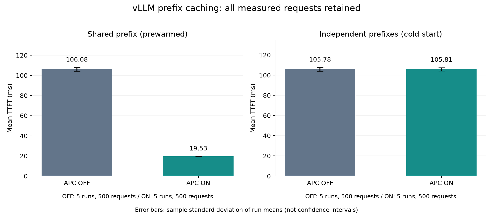

# APC 单卡对照实验报告

实验时间：北京时间 2026-10-22 23:23 至 2026-10-23 01:12。整理与复核：2026-10-26。

## 问题与结论

对同一推理服务，APC 是否只在可复用长前缀时带来明显收益？

在本次受控输入下，共享组平均 TTFT 从 **106.082 ms 降至 19.526 ms，降低 81.59%**；独立组从 105.782 ms 变为 105.809 ms，基本无变化。命中计数与这个差异一致：共享组 98.835%，独立组 0.777%。

测得的是客户端首 token 延迟改善。TPOT 变化很小，不能把上述比例表述为生成阶段加速或引擎峰值容量提升。

## 环境和控制变量

| 项目 | 记录 |
|---|---|
| GPU | RTX 4080 Laptop GPU，12282 MiB |
| 系统 | WSL Ubuntu，Python 3.12.3 |
| 运行版本 | vLLM 0.31.0；torch 2.13.0+cu132；Transformers 5.17.0 |
| 模型 | Qwen2.5-1.5B-Instruct，本地目录；revision 未记录 |
| 精度/上下文 | FP16，max_model_len=4096 |
| 缓存 | block_size=16；gpu_memory_utilization=0.85；cache_dtype=auto |
| 调度 | max_num_seqs=256；max_num_batched_tokens=2048；chunked prefill 开启 |
| 请求 | Chat Completions；客户端只发原文，由服务端套一次聊天模板 |
| 负载 | 并发上限 1，request_rate=inf，seed=42 |
| 生成 | temperature=0，ignore_eos，数据集指定输出 64 tokens |
| 重复 | 四组各 5 轮，每轮 100 请求；2000 请求全部成功 |

运行版本、模型/缓存/调度配置逐轮保存在 manifest；除了 APC 开关，保存的配置相同。[环境文本](environment.txt) 采于 10 月 21 日，只作为硬件背景，不当作每轮遥测。

## 输入与缓存控制

共享与独立输入各 100 条。两类输入实际长度均为 2039–2041 tokens；共享前缀 LCP 范围 2029–2031，独立组 27–29。10 月 26 日使用本地 tokenizer 复核，长度与历史结果逐条一致，见 [workload_check.json](workload_check.json)。这是对当前本地 tokenizer 的复核，不能补造历史模型 revision。

每个工作负载的 ON/OFF、全部轮次都复用相同文件，逐轮 SHA256 已核验。独立组短公共模板仍可能复用少量完整 block，不等于零命中。

每轮流程：
1. 用无关文本做三次服务预热。
2. ON 时 reset，核对 success=true；OFF 没有 APC 可清。
3. shared hot 额外发送第一条输入，ON/OFF 都执行同一步骤；independent cold 不执行。
4. 保存 metrics_before，运行正式 100 请求，保存 metrics_after。
5. 检查请求数、输出长度和最终状态。

cold 表示测量前清空，轮内仍可积累缓存。hot 预填充只发送第一条 shared 输入，首条可能复用更完整的输入，其余请求复用长公共前缀。

## 全量结果

所有正式请求都纳入均值；± 为各轮均值的样本标准差，不是置信区间。吞吐为各轮总输出 tokens / 各轮总测量时间。

| 条件 | TTFT ms | TPOT ms | E2EL ms | 输出 tokens/s |
|---|---:|---:|---:|---:|
| Shared OFF | 106.082 ± 1.790 | 8.924 | 668.277 | 95.738 |
| Shared ON | 19.526 ± 0.115 | 8.888 | 579.455 | 110.408 |
| Independent cold OFF | 105.782 ± 1.797 | 8.918 | 667.620 | 95.831 |
| Independent cold ON | 105.809 ± 1.651 | 8.879 | 665.170 | 96.182 |

共享组五个配对轮次的 TTFT 降低率分别为 81.77%、81.96%、81.46%、81.54%、81.22%。独立组分别为 +1.34%、−0.41%、+0.69%、−1.15%、−0.63%，方向并不一致。这里正值表示 ON 更快。

[prefix-cache-summary.csv](prefix-cache-summary.csv) 包含合并请求的描述性 P50/P95；[prefix-cache-runs.csv](prefix-cache-runs.csv) 保留逐轮指标和开始时间。500 请求来自 5 轮，不能当作 500 次独立的环境重复。

## 缓存计数证据

使用精确匹配的 `vllm:prefix_cache_hits_total` 与 `vllm:prefix_cache_queries_total`，不混入 external_prefix_cache 指标。计算前后增量：

| ON 条件 | 每轮 queries 增量 | 每轮 hits 增量 | 比例 |
|---|---:|---:|---:|
| Shared | 203992 | 201616 | 98.835% |
| Independent cold | 203992 | 1584 | 0.777% |

五轮各自的 queries 增量都等于该轮正式请求输入总 tokens，支持快照窗口覆盖正式测量。比例按计数器的 token 口径计算，不是“命中请求数/100”。OFF 两个计数器均不增长，零分母记为不适用。

## 首请求与排队口径

| 条件 | 每轮首请求均值 ms | 每轮请求 2–100 均值 ms |
|---|---:|---:|
| Shared OFF | 327.674 | 103.844 |
| Shared ON | 53.163 | 19.187 |
| Independent cold OFF | 300.059 | 103.820 |
| Independent cold ON | 315.106 | 103.694 |

首请求偏慢的根因没有被这组数据确定。准备阶段的服务预热不保证正式 benchmark 新客户端的所有首次开销都已消失；该解释是可能性，不是完成定位的结论。

TTFT/E2EL 从实际发送请求后开始计；客户端等待并发许可的时间另存 queue_times。request_rate=inf、并发上限 1 会形成客户端队列，因此不能把该 TTFT 当作外部用户从到达到首 token 的完整等待。prefix-cache-runs.csv 按逐请求 queue_time+latency 另算到达至完成 P95，而不是直接相加两个 P95。

## 验收与限制

通过：20 轮目录完整；manifest 全部 completed；输入 SHA256、配对输入、输出 tokens、成功数、平均值、P50/P95、吞吐分母、配置、reset 记录和计数增量均可复核；120 个原始证据文件保留原始字节。

仍有限制：
- 五轮均 OFF 在先、ON 在后，未按建议交替顺序；不能完全排除时间/温度漂移。
- 缺少逐轮 GPU 温度/功耗/时钟和 CPU 遥测，以及完整启动日志和不可变模型 revision。
- 无高并发、不同输入长度或长输出条件，也没有输出语义正确性评估。
- 这是单机合成负载对照，不外推到生产服务 SLA。独立组接近零的差异不作性能收益承诺。

可以作为“可复核的单卡 APC 实验”发布。后续扩展优先补交替顺序与运行遥测，再测输出 256 tokens 或更高并发。

## 实现贡献和故障复盘

实验工具包封装官方 benchmark，保留逐轮证据并拒绝失败轮、输入篡改、目录重复和统计不一致。历史探索发现并修正了重复套模板问题。

小测试曾暴露两处脚本缺陷：预热文本实际 tokens 超过上下文上限，以及未显式使用数据集输出长度而被默认 256 覆盖。修复为按真实 tokenizer 预算构造预热、传 `--custom-output-len -1`，并加入回归测试。它们属于本项目实验工具的修复，不是 vLLM 引擎优化。

方法与参数口径详见 [methodology.md](../docs/methodology.md)。
